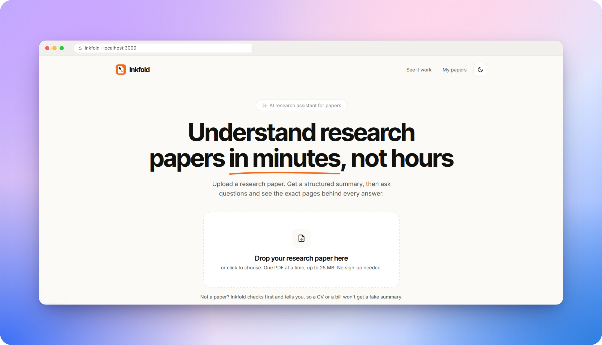
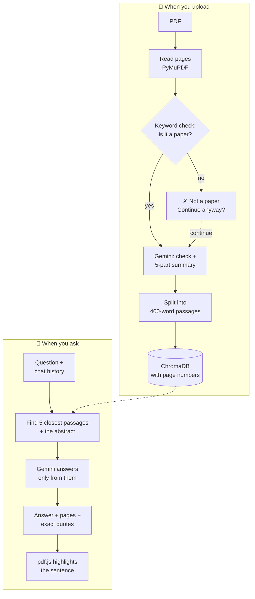

<div align="center">
  

  <h1>Inkfold</h1>

  <p>Upload a research paper, get a clear summary, and ask questions.<br>Every answer shows the page and the exact sentence it came from.</p>

  [![Stars][stars-shield]][stars-url]
  [![Forks][forks-shield]][forks-url]
  [![Issues][issues-shield]][issues-url]
  [![MIT License][license-shield]][license-url]
</div>

<br>

[](https://drive.google.com/file/d/1NS4pUn7bZhbmvNXr-q6BBFwjP0dMjLLg/view)

<p align="center"><a href="https://drive.google.com/file/d/1NS4pUn7bZhbmvNXr-q6BBFwjP0dMjLLg/view">▶️ Click the image to watch the demo</a></p>

## 📖 About

I built Inkfold for Mitra Innovation's technical assessment: a research assistant for PDFs. You upload one paper, Inkfold writes a five-part summary, and you can chat with the paper. Answers come only from the paper, so each one cites its pages, and clicking a citation opens the PDF with the sentence highlighted.

## ✨ Features

**From the brief**
- Upload one research paper (PDF) at a time
- Structured summary: Title & Authors and Abstract, Problem Statement, Methodology, Key Results, Conclusion
- Question answering over the paper with RAG

**Extras**
- Page citations, with the exact sentence highlighted in the PDF viewer
- Paper check: CVs, bills and other non-papers are caught before the AI is called, with a "Continue anyway" option
- Chat memory, so follow-ups like "explain please" work
- Answers in English, Sinhala or Tamil
- Quiz me: five multiple-choice questions with explanations and page links
- Cite the paper in APA or BibTeX, and export the summary as Markdown
- Guest mode, or sign in with Supabase (Google or an email link). Guest papers are deleted after 12 hours
- Dark mode, PDF zoom and drag, and a layout that works on phones

## 🛠️ Built with

| Part | Tools |
|---|---|
| Frontend | Next.js (React), Tailwind CSS, pdf.js |
| Backend | Python, Flask, PyMuPDF |
| AI | Google Gemini (chat and embeddings) |
| Search | ChromaDB |
| Sign-in and history | Supabase (optional) |

## ⚙️ How it works



1. The backend reads the text of every page with PyMuPDF.
2. A free keyword check (abstract, references, et al and so on) stops obvious non-papers. Gemini checks again while it summarises.
3. Gemini writes the five summary sections and three suggested questions as JSON.
4. The text is split into 400-word passages with a 50-word overlap. Each passage keeps its page number and is stored in ChromaDB with a Gemini embedding.
5. For a question, the 5 closest passages plus the paper's opening are sent to Gemini, which answers only from them, cites pages and copies the sentence it used.
6. In the browser, pdf.js draws the cited page, finds that sentence and highlights it.

The prompts are in [`backend/prompts.py`](backend/prompts.py).

## 🚀 Getting started

You need **Python 3.10 to 3.12**, **Node.js 20+** and a free **Gemini API key** from [Google AI Studio](https://aistudio.google.com/apikey).

```bash
git clone https://github.com/ImDenuwan/Inkfold.git
cd Inkfold
```

1. Start the backend: [backend/README.md](backend/README.md)
2. Start the frontend: [frontend/README.md](frontend/README.md)
3. Open http://localhost:3000 and upload a paper

Supabase is optional. Without it, everyone uses Inkfold as a guest.

## 📁 Project structure

```
Inkfold/
├── backend/    Flask API: reading, RAG, prompts, sign-in, history, cleanup
├── frontend/   Next.js app: landing page, workspace, sign-in, privacy
└── images/     logo and screenshots
```

## 🗺️ Roadmap

- [x] Five-part summary and RAG chat
- [x] Page citations with highlighted sentences
- [x] Quiz, citations and export
- [x] Sinhala and Tamil answers
- [x] Supabase sign-in and guest cleanup
- [ ] Stateless backend: PDFs in Supabase Storage and vectors in pgvector, so it can run on any host
- [ ] Optional local model through Ollama
- [ ] Compare several papers

## 📄 License

MIT. See [LICENSE](LICENSE).

## 🙏 Acknowledgments

- Developed with AI-assisted tooling (Claude).
- The reading animation is adapted from [Aceternity UI](https://ui.aceternity.com).
- README layout inspired by [Best-README-Template](https://github.com/othneildrew/Best-README-Template).

[stars-shield]: https://img.shields.io/github/stars/ImDenuwan/Inkfold.svg?style=for-the-badge
[stars-url]: https://github.com/ImDenuwan/Inkfold/stargazers
[forks-shield]: https://img.shields.io/github/forks/ImDenuwan/Inkfold.svg?style=for-the-badge
[forks-url]: https://github.com/ImDenuwan/Inkfold/network/members
[issues-shield]: https://img.shields.io/github/issues/ImDenuwan/Inkfold.svg?style=for-the-badge
[issues-url]: https://github.com/ImDenuwan/Inkfold/issues
[license-shield]: https://img.shields.io/github/license/ImDenuwan/Inkfold.svg?style=for-the-badge
[license-url]: https://github.com/ImDenuwan/Inkfold/blob/main/LICENSE
